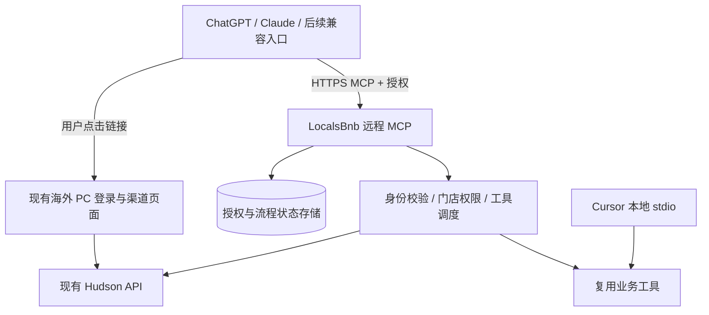

# LocalsBnb 远程 MCP 与多平台接入开发计划

> 更新日期：2026-10-10
> 状态：M04–M06 实现与本机自动化完成；M07 统一人工验收待开始；尚未部署公网或送审。
> 首批入口：ChatGPT、Claude；后续评估 Gemini、Perplexity、Microsoft Copilot。
> 目标：用户安装/连接后完成一次登录；单门店自动选择，多门店选择一次，即可对话使用。

## 1. 当前执行位置与范围

**当前执行位置（2026-10-10）：M07 验收准备。** 用户已授权开发至 M07 后统一验收。独立远程服务已接入 OAuth、请求级身份、按 scope 暴露的业务工具、门店会话、持久预览/确认和四渠道开链。本机 Docker MCP + PostgreSQL + Redis 已启动，业务就绪检查通过。原本地 stdio 启动与凭证方式保留。

验证：20 套件 / 254 项 MCP 离线测试、原两种 stdio 实际握手、真实 PG/Redis 的授权至 MCP 链路、跨实例会话/预览/基线恢复与并发确认通过；PC 60 项 AI 测试与完整 dev 构建通过。自动化使用模拟 Hudson，没有真实渠道授权或业务写入。详见 [M07 统一验收清单](./remote-mcp-m07-acceptance.zh-CN.md) 与[本地运行说明](../../deployment/remote/README.md)。

**尚需用户统一验收：** HTTPS 域名/TLS、真实平台 client/callback、PC dev 部署、真实账号/门店与手机；新账号没有已有 Secret 时仍需 Hudson 幂等开通接口。远程只读取 `/user/secret/get`，不调用可能使本地 APP_SECRET 失效的 generate。已有 Secret 的测试账号可以开始 M07；M03 不标记为全部用户场景验收通过。

代码落点仍为 MCP `main / 8ca70e3`、PC `dev / 821ef05` 之上的工作区改动，未 commit/push/发布；`locals-hudson-provider` 本轮未改。容器仅本机运行，`mcp.example` 是占位 issuer，不能用于真实平台连接。M08/M09 未开始。

已有渠道查询、映射、运营写工具和 Handshake 能力可复用。既有进度见 [AI Onboarding 交接](./ai-onboarding-xcode-handoff.zh-CN.md)，验收方法见 [S08/S09 验收](./s08-s09-acceptance.zh-CN.md)。旧文档中的提交位置和“未提交”描述存在历史快照，不覆盖本计划上述代码基线。

本计划不重写 Hudson 业务，不迁移订单/房态主数据，也不要求用户安装 Node、填写 App Secret 或提供门店 ID。保持现有 Cursor 本地接入可用。

## 2. 用户流程

### 2.1 首次连接

```text
打开插件/连接器入口
  → 安装或添加 LocalsBnb
  → 点击“连接账号”
  → LocalsBnb 网页登录/注册（已有登录态时复用）
  → 确认授权
  → 单门店自动选择 / 多门店按名称选择
  → 返回聊天
  → 直接提出查询或操作需求
```

“用户安装入口”由各平台决定；公开市场发布前使用账号允许的自定义连接入口测试。账号权限、地区及功能开放情况需要实际验证，不能承诺所有用户都有入口。

### 2.2 日常操作

| 场景 | 用户操作 | 系统行为 |
|---|---|---|
| 查询 | “今天有哪些入住？” | 使用授权身份、当前门店和门店时区查询 |
| 写操作 | 提出需求 → 查看预览 → 明确确认 | 重验权限、资源和预览状态，提交一次并回查 |
| 切店 | “切换到某某店” | 只展示有权访问的门店，切换当前会话，旧写预览失效 |
| 授权过期 | 正常情况下无需额外操作 | 可续期则续期，失败则提示重新连接 |
| 断开连接 | 撤销授权 | 停止使用对应授权，按保留策略清理凭证与会话 |

平台可能另有原生写入确认，不能承诺完全消除平台确认步骤。

### 2.3 渠道关联

```text
“连接 Airbnb / Booking / Trip / Agoda”
  → 记录当前门店对应渠道的基线快照
  → 返回“前往连接”链接
  → 用户点击，打开手机或桌面浏览器
  → 短期 Handshake 建立门店绑定的网页登录态
  → 用户完成授权、导入或映射
  → 返回原聊天，只回复“已完成”
  → 查询并比较门店/房型/映射与连接状态
      ├─ 正常：展示结果，结束
      ├─ 未变化或同步中：保留基线，提示稍后再核对
      └─ 异常：提示回网页处理
```

M06 已在独立远程路径实现四渠道统一 ticket；PC `/ai/connect` 服务端兑换后保留 Cookie 和门店。原本地路径保持兼容，真实手机与渠道账号在 M07 验收。

列表变化是观察证据，不证明一定由本次网页操作产生；仅账号新增、同步时间或名称变化不能判定房源关联完成。网页已完成导入后，聊天不得再次自动导入。

## 3. 架构与部署



- **仓库**：优先在 `localsbnbAi` 增加 HTTP 入口；保留 stdio 入口，共享业务模块。
- **运行**：远程 MCP 独立 Node 进程或容器；可复用服务器与 Jenkins，不要求新建代码仓库。
- **业务**：继续调用 Hudson；海外 PC 承担网页授权及渠道操作。
- **存储**：优先复用现有数据库实例，独立 schema/表和访问权限。Redis 可选，不能在存储能力未确认前锁定实现。
- **环境**：dev/prod 分离凭证、授权配置与存储；浏览器历史环境选择不得改变会话绑定的后端。
- **多平台**：共用服务和业务数据，分别注册授权客户端、维护回调地址及执行兼容验收。

### 3.1 两种授权关系必须分开

1. **平台连接授权**：ChatGPT/Claude 取得面向远程 MCP 的访问令牌，MCP 验证签发者、受众、有效期和权限；不把 Hudson App Secret 当作通用平台令牌透传。
2. **网页登录态**：用户点击短期链接后建立 Cookie，供渠道网页使用；ticket 过期与已建立的浏览器会话有效期分开管理，撤销和过期规则须明确。

远程服务不得共享单个 `~/.localsbnb/credentials.json` 作为所有用户身份，不得信任模型传入的用户 ID 或 campId 作为授权依据。现有本地凭证方式只在 stdio 模式保留。

### 3.2 最小存储范围

| 数据 | 保存内容与约束 |
|---|---|
| 授权连接 | 用户与平台客户端关系、权限、加密后的必要凭证、有效期和撤销状态 |
| 会话 | 用户、连接、服务端会话与当前门店；有期限，不依赖平台一定提供聊天 ID |
| 渠道流程 | 绑定门店/渠道、基线快照、有效期及结果 |
| 写预览 | 工具、参数摘要、资源快照、权限范围、有效期及原子消费状态 |
| 操作结果 | 操作 ID、提交/失败/结果未知、回查结果和脱敏审计信息 |
| Handshake | 短期 ticket、绑定身份/门店/目标路径、消费和过期状态 |

远程请求不能继续仅依靠 APIClient 对象身份、WeakMap 或进程内 Map 关联用户流程。跨请求及多实例需要稳定的服务端绑定。

写入预览的原子消费防止同一预览重复提交，但不能替代 Hudson 幂等能力；提交超时且结果未知时先回查，不盲目重试。数据保留期限、凭证加密密钥和删除策略在 M01 确定。

## 4. M01–M09 开发任务与验收

**当前执行位置：M07 统一验收准备，真实平台和手机验收尚未开始。**

- **M01–M06：** 设计与主要实现已落地；仍有部署、真实验收及 M03 新账号 Secret 开通缺口。
- **M07：** 验收清单和自动化准备完成，等待统一人工验收。
- **M08–M09：** 尚未开始送审与发布。

各阶段的实现、测试、部署和验收分别记录；下列状态不代表全部上线完成。

### M01 接入设计

**当前状态：** 设计与本地配置落地；公网域名待分配。

- **工作与交付物：** 基础设施清单、OAuth 能力核查、身份/会话模型、存储设计、环境配置与回退方案。
- **完成标准：** 部署、身份归属、授权撤销和存储方案无未决阻塞，形成设计记录。
- **依赖条件：** 域名待分配、存储连接待接入。

### M02 远程 MCP

**当前状态：** 独立入口、Docker 构建/启动及本地 stdio 回归通过；公网待部署。

- **工作与交付物：** HTTP 入口、Streamable HTTP、协议协商、请求级上下文、健康检查、容器及部署配置；评估 SDK 升级。
- **完成标准：** 远程客户端能连接/list/call；本地 stdio 回归通过；不共享全局用户状态。
- **依赖条件：** M01。

### M03 登录授权

**当前状态：** 登录/MFA/同意、OAuth、真实 PG/Redis 链路通过；新账号幂等 Secret 和真实账号验收待补。

- **工作与交付物：** 复用或新增 OAuth 授权服务、发现元数据、授权码与 PKCE、续期/撤销、平台客户端注册兼容。
- **完成标准：** 用户点连接即可授权；错误受众/无效令牌被拒绝；撤销后不可继续调用。
- **依赖条件：** LocalsBnb 登录桥接与存储。

### M04 用户与门店隔离

**当前状态：** 实现及真实 PG + 模拟业务隔离回归通过；真实权限待验收。

- **工作与交付物：** 按身份查询可访问门店；单店自动选择、多店选择；会话切店；远程工具按权限暴露。
- **完成标准：** 两用户及同用户两会话并发不串身份/门店；越权 campId 被拒绝；旧预览切店后不可用。
- **依赖条件：** M02/M03。

### M05 流程持久化

**当前状态：** 持久 CAS、重建实例恢复、unknown 不重试通过；不承诺后端 exactly-once。

- **工作与交付物：** 将快照、预览、操作结果迁移至存储抽象；TTL、原子消费、结果未知处理、审计。
- **完成标准：** 重启和跨实例仍可恢复；并发确认最多一次提交；回查失败不重复写入。
- **依赖条件：** M04、数据库及后端幂等契约。

### M06 统一开链

**当前状态：** 四渠道、一次性兑换与 PC 测试通过；PC 待发布，真连待验。

- **工作与交付物：** 四渠道 Handshake、目标路径白名单、ticket 消费、Cookie/门店/环境保留；远程返回链接。
- **完成标准：** 手机点击后可完成网页操作；回复“已完成”找到正确流程；失效链接不泄露凭证。
- **依赖条件：** M03–M05、PC 改造。

### M07 真实入口验收

**当前状态：** 清单与自动化准备完成；用户统一验收待开始。

- **工作与交付物：** ChatGPT + Claude 手机/网页；查询、写确认、续期、撤销、切店、开链返回、多用户并发。
- **完成标准：** 测试矩阵有脱敏证据；无账号项目明确暂缓，不伪记通过。
- **依赖条件：** 平台权限、测试账号与门店。

### M08 分平台送审准备

**当前状态：** 待准备。

- **工作与交付物：** 包装插件/连接器，介绍、图标、隐私及支持链接、演示、测试用例、审核账号。
- **完成标准：** 对应平台所需资料与自动检查完成；明确公众分发路径。
- **依赖条件：** 稳定服务、发布者身份验证。

### M09 发布与运营

**当前状态：** 待发布。

- **工作与交付物：** 按平台批准后发布，入口文档、监控告警、回滚、撤销及故障处理。
- **完成标准：** 用户能发现/连接/使用；请求可追踪，故障可回退；发布证据已回填。
- **依赖条件：** 平台审核及明确发布安排。

M02 的早期验证使用模拟身份或受限测试环境；M03/M04 完成前不开放真实多用户业务数据。

具体操作与证据记录见 [M07 统一验收清单](./remote-mcp-m07-acceptance.zh-CN.md)。

## 5. 交付批次与工期估算

假设：一名熟悉项目的工程师配合 AI；现有业务工具可复用；环境、授权系统资料和测试资源及时提供。以下为工程估算，不是平台审核承诺。

| 批次 | 内容 | 估计投入 | 可交付结果 |
|---|---|---|---|
| 第一批 | M01–M04 | 5–8 个工作日 | 私有测试连接、登录、门店选择、手机查询；保留本地模式 |
| 第二批 | M05–M07 | 5–8 个工作日 | 写预览/确认/回查、渠道开链、持久化与双平台验收 |
| 第三批 | M08–M09 工程准备 | 3–5 个工作日 | 送审资料、部署监控、回退及发布准备 |

总工程投入约 **13–21 个工作日，排期建议 3–5 周**。审核、账号申请、资料等待与渠道同步时间另计；真正公开上线日期取决于审批和验收结果。若须从零建立 OAuth 服务，应在 M01 完成后重新估时，不把它当作普通登录接口包装。

Gemini、Perplexity、Copilot 的专项适配不包含在上述首批估算内；共用服务不意味着无需逐平台测试。

## 6. 多平台适配矩阵

| 入口 | 优先级 | 计划方式 | 必须单独验证 |
|---|---|---|---|
| ChatGPT | 首批 | 远程 MCP，自定义连接先测，插件市场后发 | 账号可用入口、OAuth、手机开链、工具刷新、写确认和送审 |
| Claude | 首批 | 远程 MCP Connector | 授权注册方式、手机使用、会话恢复、工具调用及分发入口 |
| Cursor | 保持兼容 | 原 stdio 保留，可补远程配置 | 本地启动、工具可见性和既有工作流无回退 |
| Gemini | 第二批评估 | Custom Connected Apps / 对应企业入口 | 地区、语言、账号及 Spark 开放限制，网页配置后手机使用 |
| Perplexity | 第二批评估 | Custom Remote Connector | 套餐、OAuth 兼容、手机功能覆盖和工具执行 |
| Microsoft Copilot | 企业需求驱动 | Copilot Studio Agent 接 MCP 后发布对应渠道 | 许可证、租户权限、目标渠道及分发要求 |

远程 MCP 是共用协议基础，不是统一市场。ChatGPT 插件 ZIP 不自动发布到其他平台；各平台手机端也不运行本项目的本地 Node 进程。

## 7. 核心验收用例

| 编号 | 用例 | 通过标准 |
|---|---|---|
| A01 | 新用户连接，只有一个门店 | 一次网页登录授权，无需填 token/门店 ID，可查询 |
| A02 | 多门店与同用户两段会话 | 按名称选店；每个会话的切店不影响另一会话 |
| A03 | 两用户并发、伪造 campId | 不串数据；服务端独立拒绝越权访问 |
| A04 | 授权续期、撤销、错误受众 | 正确续期或提示重连；撤销/非法令牌不可使用 |
| A05 | 历史 prod 浏览器配置打开 dev 链接 | 绑定 dev 门店和后端，不把 dev 凭证发往 prod |
| A06 | ticket 到期、重复使用与会话保留 | ticket 按规则拒绝；合法已建立网页登录态按会话期限管理 |
| A07 | 四渠道开链后回复“已完成” | 找到对应流程；实际映射正常才结束；无变化保留基线 |
| A08 | 服务重启、请求落到另一实例 | 会话与预览正确恢复或明确失效，不误用其他用户状态 |
| A09 | 预览到确认之间参数/价格/门店变化 | 拒绝旧确认，重新生成准确预览 |
| A10 | 重复确认、并发确认、提交超时 | 不盲目重复写；结果未知可追踪并回查 |
| A11 | ChatGPT 与 Claude 手机真机 | 点击开链、网页登录、返回聊天、工具结果均可操作 |
| A12 | 本地 stdio 回归 | Cursor 原有直配凭证与本地工具仍可用 |

测试使用专用门店与样例数据。真实写入按具体测试授权执行并记录恢复情况；报告不包含 token、Cookie、完整 ticket 或真实客人敏感信息。

## 8. 与 S07–S10 的关系

- **S07**：原本地/旧 PC 路径保持暂停。本轮在用户授权的 M05/M06 独立远程路径恢复持久状态、一次性 ticket 和授权关联，未替换旧 `/ai/handshake` 或本地存储。
- **S08**：复用渠道工具和快照比较；补远程会话以及 Booking/Trip/Agoda 登录态注入。
- **S09**：复用改价、开关房、录单、脏净房工具；把内存预览机制调整为远程多用户可用版本。
- **S10**：真实 Airbnb 授权/导入纳入 M07；没有账号时标记暂缓。基础设施验收通过不代表真实 OAuth 通过。
- **初始化修复**：既有绑定门店初始化与 Cookie 改动需要在线验证，不凭提交号认定已经部署通过。

## 9. 开始前需要确认的信息

| 信息 | 需要什么 | 未提供时可推进的工作 |
|---|---|---|
| 服务器与域名 | 可部署位置、dev/prod 域名、Jenkins 负责人、网络访问条件 | 接口与配置草案、本地受限验证 |
| 登录授权系统 | 是否已有 OAuth；登录页面/接口说明、权限及 App Secret 生命周期 | 授权适配设计，不能假设普通登录等于 OAuth |
| 存储 | 可用数据库类型、版本；是否有 Redis；密钥管理方式 | 存储接口、表结构草案、模拟测试 |
| 试用范围 | 自用验证或多房东试用；首批平台账号权限 | 通用协议与本地回归 |
| 测试资源 | dev 测试门店、可恢复的写资源、渠道测试账号 | 离线回归；真实渠道验收保持待办 |
| 上架身份 | 企业/个人发布者、隐私与支持页面、审核测试账号 | 插件清单和资料模板 |

先提供非敏感配置说明即可，密码、密钥不放进聊天或 Git。涉及以上信息的依赖工作在缺失时停下询问，其他独立任务继续推进。

## 10. 进度回填规则

每阶段分别记录：实现、离线测试、真实入口验收、提交、部署、平台审核。建议完成一项即回填：

| 阶段 | 日期 | 代码提交 | 测试证据 | 部署版本 | 剩余问题 / 下一步 |
|---|---|---|---|---|---|
| 计划文档 | 2026-10-09 | 本次文档工作区改动，尚未提交 | 文档结构与本地链接检查 | 无 | 确认 M01 所需环境与授权信息 |

## 11. 官方参考与时效

以下基于本次对话于 2026-10-09 查阅的官方资料；开发和送审时再次确认，平台入口、套餐、地区、协议及审核要求可能变化。

- [ChatGPT 插件使用范围](https://learn.chatgpt.com/docs/plugins)
- [ChatGPT 自定义 MCP 接入](https://developers.openai.com/api/docs/guides/custom-mcp-server)
- [ChatGPT 插件上传与提交](https://developers.openai.com/plugins/deploy/submission)
- [Claude 远程 MCP Connector](https://support.claude.com/en/articles/11175166-get-started-with-custom-connectors-using-remote-mcp)
- [Gemini 自定义 Connected Apps](https://support.google.com/gemini/answer/17209137?hl=en)
- [Perplexity 自定义连接器发布说明](https://www.perplexity.ai/en-GB/changelog/what-we-shipped---march-13-2026)
- [Copilot Studio 添加 MCP 工具](https://learn.microsoft.com/en-us/microsoft-copilot-studio/mcp-add-components-to-agent)
- [Cursor MCP](https://docs.cursor.com/context/model-context-protocol)

### 初始执行记录：2026-10-09（后续进展见下一节）

用户已要求开始执行。完成后端只读核查、设计记录、`src/remote/config.ts` 和 26 项边界测试；类型检查及新增文件 lint 通过。未改后端、未连数据库、未部署、未提交。后续依赖 dev 域名与 OAuth 服务归属确认。

### 用户确认后的执行记录

独立 MCP 服务及 PostgreSQL/Redis 方案确定；域名未分配、无现成 OAuth。用户选择先本地 Docker。2026-10-09 已启动 PostgreSQL 16.15 / Redis 7.2.16，仅绑定本机端口，容器健康。

- M02：本机 SDK HTTP 模拟原型与环境配置校验完成，真实业务入口未开放。
- M03：PKCE/授权码、Redis 原子消费、PostgreSQL 加密授权记录已实现；真实存储验证通过 12 路并发一次成功、重放/过期拒绝、客户端/resource 隔离、篡改拒绝和授权撤销。SQL 迁移在测试事务内回滚，未永久应用。
- 最新验证：16 套件、220 项离线测试通过；新增模块 lint、类型检查和本地 stdio 实际握手通过。本轮排除真实 live/smoke 测试，上轮 9 项 Token 无效尚未验收。
- 下一步：服务端登录校验与授权同意桥接，授权端点及独立入口组装，再接 M04 身份和门店隔离。
- 尚未完成：完整 OAuth、正式存储密钥管理、dev 发布、真实业务和跨平台/手机验收。当前无需为本地验证分配公网域名。

运行及复测步骤见 [本地 Docker 说明](../../deployment/remote/README.md)。

### 本轮新增：令牌核心与本地部署保护

- 令牌核心已实现：摘要存储、访问认证、刷新轮换、历史 refresh 重放撤销、主动撤销、每次调用复核 PostgreSQL 授权；真实 Docker 存储验证通过。
- 本地部署保持原入口/命令/SDK/凭证方式；新增 `test:local:compat`，临时构建移除 remote 后实际启动 `index.js` 和 `run.cjs`，initialize/tools/list 均成功。
- 下一步仍是登录同意桥接与完整 HTTP OAuth 接入；M03 未完成，M04–M09 状态不变。代码未提交、未部署 dev。

### 本轮新增：OAuth HTTP 路由组件

2026-10-09：发现元数据、授权码兑换、刷新、撤销和预登记客户端认证完成；11 项接口测试通过，总计 16 套件、220 项离线测试通过。原本地入口两种启动方式实际握手继续通过。

当前仅新增可组装路由组件，尚未挂载至 `dev:remote:mock`，没有新增可对外部署的服务入口。登录同意、`/authorize`、生产限流和 TLS/代理仍待完成，M03 未整体完成。下一步先打通可信登录与授权同意，保留本地 stdio 启动方式。


## 2026-10-10：M04–M07 本轮交接

- M04：每请求独立 Hudson 客户端，门店/认证不可覆盖；工具按 scope 过滤。对话独立 sessionId，切店递增 epoch，旧预览与流程失效；同一会话 CAS 串行，两会话可并发。
- M05：新增 `mcp_auth.work_items`；快照、预览与结果加密持久化；确认前复核资源/币种/时区；提交前原子占用，响应丢失记 unknown，不自动重试；操作 ID 可回查。
- M06：Airbnb/Booking/Trip/Agoda 快照基线 + 120 秒一次性 URL；PC 服务间密钥兑换，Cookie/门店/环境保留，用户只回复“已完成”。仅账号变化不成功，重开链接不丢基线。OAuth 撤销同时使未兑换链接失效。
- M07：已整理逐项话术、预期结果、手机/网页矩阵、故障回归与证据模板；真实平台/账号未执行，不记通过。当前先准备域名、平台 client/callback、两用户/多门店测试资源，再按清单验收。
- Docker：镜像使用独立冻结锁；本地应用两份迁移，mcp 容器只映射 loopback，业务就绪通过。运行配置和密钥保存在 Git 忽略的 0600 文件，不回显。
- 已知边界：没有 DCR/CIMD；预登记精确回调；新账号 Secret 自动开通未解决；反代共享限流需容量评估；崩溃/结果未知需人工核对；真实渠道/移动端和公网发布待完成。

主要代码：`src/remote/business/`、`src/remote/runtimeServer.ts`、`deployment/remote/`；PC 新增 `lib/ai/remoteHandshake.ts`、`pages/ai/connect/[ticketId].tsx` 与测试，补公开路由和 API 环境隔离。原本地入口未替换。提交、推送、Jenkins、平台上架均未执行。
